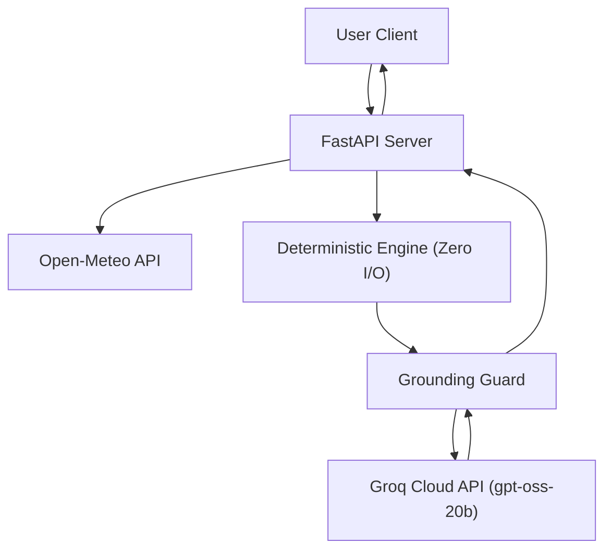

# SaansPlan — Urban Air Quality & Winter Smog Assistant

[](https://github.com/CodeWithMehru/saansplan/actions/workflows/ci.yml)
[](https://www.python.org/downloads/release/python-3130/)
[](https://fastapi.tiangolo.com)
[](https://www.w3.org/WAI/standards-guidelines/wcag/)
[](LICENSE)

SaansPlan is an intelligent, accessible urban air-quality assistant for North Indian families navigating severe winter smog. It converts hourly atmospheric dispersion data into actionable low-emission daily routines, indoor air-quality interventions, and sustainable alternatives with clear impact explanations.

**Live Application:** [https://saansplan.onrender.com](https://saansplan.onrender.com)  
*(Deployed on Render free tier; cold starts take ~60s).*

---

## 1. Problem Statement Alignment

Winter atmospheric inversions across North India trap particulate matter ($PM_{2.5}$) in the breathing zone. SaansPlan bridges atmospheric science and household decisions:

- **Inhaled Dosage in Micrograms:** Replaces raw index numbers with estimated $PM_{2.5}$ inhaled in physical micrograms ($\mu\text{g}$) with $\pm 25\%$ uncertainty bounds.
- **CPCB National AQI:** Implements official Central Pollution Control Board breakpoints and advisories.
- **5-Day Winter Smog Forecast:** Flags diurnal boundary-layer windows (optimal afternoon airing 12:00–15:00) and wind-stagnation alerts (< 2 m/s).
- **Cleaner Day Optimizer:** Shifts flexible outdoor routines away from morning and evening peak smog.
- **Indoor IAQ & Purifiers:** AHAM 2/3 Clean Air Delivery Rate (CADR) sizing and EPA DIY box-fan filter guide.
- **Emissions & Cost:** Weekly carbon ($kg\text{ }CO_2e$) and monetary ($\text{INR}$) comparison by budget tier.
- **Multilingual Accessibility:** English, Hinglish, and Hindi with high contrast, WCAG 1.4.12 text spacing, and screen-reader optimizations.

Evaluation criteria mappings are documented in [docs/UPGRADES.md](docs/UPGRADES.md).

---

## 2. System Architecture

Mathematical simulations, CADR sizing, emissions, and schedule optimizations run in a **pure, deterministic, zero-I/O calculation engine**. The LLM is restricted to natural language translation and grounded explanations.



### Division of Labor

| Concern | Deterministic Engine (Zero I/O) | Large Language Model (Groq) |
|---|---|---|
| **Exposure Calculation** | Pure physical dosage ($\mu\text{g}$) and CPCB categories | Forbidden from computing numbers |
| **Indoor CADR & Sizing** | Exact AHAM 2/3 volumetric formula | None |
| **Schedule Optimization** | Deterministic minimum-pollution slot search | None |
| **Routine Parsing** | Fallback template parser | Extracts activities from free-text |
| **Plan Explanation** | Number Guard validates all numerals | Synthesizes conversational explanation |
| **Grounded Assistant** | Clinical symptom interception (`check_safety`) | Synthesizes verified knowledge base entries |

Detailed design decisions are documented in [docs/ARCHITECTURE.md](docs/ARCHITECTURE.md).

---

## 3. Quick Start & Local Setup

### Prerequisites
- Python 3.13 (`python3 --version`)
- Node.js 18+ (`node --version`)
- Make (`make -v`)

```bash
# 1. Clone repository & install dependencies
git clone https://github.com/CodeWithMehru/saansplan.git && cd saansplan
python3 -m venv .venv && source .venv/bin/activate
pip install -r requirements.txt -r requirements-dev.txt

# 2. Configure environment (optional: Groq key for live LLM explanations)
cp .env.example .env

# 3. Run automated verification suite
make check && make test && make test-js

# 4. Start local development server
uvicorn app.main:app --reload --host 127.0.0.1 --port 8000
```
Open [http://127.0.0.1:8000](http://127.0.0.1:8000) in your browser.

---

## 4. API Endpoints Summary

All endpoints return uniform JSON envelopes with defensive security headers (`Content-Security-Policy: default-src 'self'`, `X-Content-Type-Options: nosniff`).

| Method | Endpoint | Description |
|---|---|---|
| `GET` | `/health` | Health probe, uptime, and cache statistics |
| `POST` | `/api/plan` | Personalized plan: timeline, cleaner day, CADR, emissions |
| `POST` | `/api/ask` | Grounded Q&A assistant with cited KB IDs or doctor redirect |
| `GET` | `/api/geocode` | City autocomplete search returning normalized coordinates |
| `GET` | `/accessibility` | Dedicated WCAG 2.2 AA audit disclosure page |
| `GET` | `/.well-known/security.txt` | RFC 9116 security disclosure policy and contact |

Rate limits: `30/min` on `/api/plan`, `15/min` on `/api/ask`, `60/min` on `/api/geocode` (returns RFC 6585 `Retry-After: 60` on 429).

---

## 5. Environment Variables Matrix

| Variable | Default Value | Required | Purpose |
|---|---|---|---|
| `GROQ_API_KEY` | `None` | Optional | Groq Cloud key (falls back to templates when unset) |
| `GROQ_MODEL` | `openai/gpt-oss-20b` | No | LLM model for routine parsing and explanation |
| `ENVIRONMENT` | `production` | No | Runtime mode (`production` disables interactive `/docs`) |
| `TRUST_PROXY` | `false` | No | Respects `X-Forwarded-For` from reverse proxies for rate limiting |
| `CORS_ORIGINS` | `http://localhost:8000` | No | Comma-separated allowed origins for CORS headers |

---

## 6. Production Deployment

### Docker Container
Production-hardened `Dockerfile` running as unprivileged user `saansplan` with built-in stdlib `HEALTHCHECK`:
```bash
docker build -t saansplan:latest .
docker run -p 8000:8000 -e ENVIRONMENT=production saansplan:latest
```

### Render Cloud Deployment
Configured via `render.yaml` with Python 3.13 pinned (`.python-version` and `PYTHON_VERSION=3.13.0`) avoiding compilation under memory limits.

---

## 7. Verification & Quality Gates

Run the automated verification pipeline locally:

```bash
make check       # Format, style (ruff), typing (mypy --strict), frontend (ESLint/Prettier/TSC), docs consistency
make test        # Pytest test suite with enforced >= 95% coverage gate
make test-js     # Native Node.js test runner for frontend i18n and utilities
make security    # Static security scan (bandit) and dependency audit (pip-audit)
make a11y        # Playwright + Axe-Core automated WCAG 2.2 AA audit (0 violations)
make quality     # AST cyclomatic complexity (Rank A) and 100% docstring coverage audit
make report      # Regenerate docs/TEST_REPORT.md benchmark and coverage figures
```

Reports are recorded in [docs/TEST_REPORT.md](docs/TEST_REPORT.md) and [docs/CODE_QUALITY.md](docs/CODE_QUALITY.md).

---

## 8. Responsible AI & Safety Safeguards

1. **Estimates, Not Medical Advice:** Inhaled dosages ($\mu\text{g}$) and percentage reductions are planning estimates with $\pm 25\%$ uncertainty bounds.
2. **Deterministic Number Guard:** LLM output is verified by `app/services/guard_numbers.py`. Every numeral must match an engine fact or standard 12-hour clock notation; ungrounded numbers trigger deterministic fallback.
3. **Clinical Symptom Redirection:** Inquiries indicating acute respiratory distress ("chest tightness", "wheezing", "severe breathlessness") or requesting medication are intercepted before reaching the LLM for immediate clinical redirect.
4. **Prompt Demarcation:** User routine strings are wrapped in XML tags (`<user_routine>`) and verified against a 57-vector injection corpus (`tests/security/test_prompt_injection.py`).
5. **Zero User Data Retention:** Stateless backend; no databases, no routine logging, and coordinates are rounded to 2 decimal places in cache keys (~1.1 km spatial resolution).

---

## 9. Assumptions & Limitations

- **Breathing Rates:** Calculations utilize US EPA Exposure Factors Handbook adult and pediatric inhalation volumes; actual intake varies with exertion.
- **Model Dispersion:** Open-Meteo uses European Copernicus (CAMS) atmospheric models, capturing regional patterns and inversions; localized micro-plumes may deviate.
- **CPCB Scale:** CPCB National AQI is standardized on 24-hour averages; SaansPlan applies breakpoints to hourly forecasts for actionable real-time guidance.
- Full details in [docs/ASSUMPTIONS.md](docs/ASSUMPTIONS.md).

---

## 10. Data Sources & Attribution

- **Open-Meteo Air Quality & Weather API:** Hourly atmospheric $PM_{2.5}$, AQI, and wind speed from [Open-Meteo.com](https://open-meteo.com/) ([CC BY 4.0](https://creativecommons.org/licenses/by/4.0/)).
- **Groq Cloud API:** High-speed cloud inference for `openai/gpt-oss-20b`.
- **CPCB National AQI Standards:** MoEFCC / Central Pollution Control Board ([PIB Release 110654](https://pib.gov.in/newsite/PrintRelease.aspx?relid=110654)).
- **AHAM AC-1 Standards:** Association of Home Appliance Manufacturers 2/3 CADR rule for particulate air cleaners.

---

## 11. Documentation Index

- [docs/ARCHITECTURE.md](docs/ARCHITECTURE.md) — Layered unidirectional architecture, component relationships, and DFD
- [docs/SECURITY.md](docs/SECURITY.md) — STRIDE threat model, production security headers, and disclosure policy
- [docs/TEST_REPORT.md](docs/TEST_REPORT.md) — Automated test suite results, coverage measurements, and execution benchmarks
- [docs/CODE_QUALITY.md](docs/CODE_QUALITY.md) — AST complexity analysis, docstring audits, and maintainability metrics
- [docs/ACCESSIBILITY.md](docs/ACCESSIBILITY.md) — WCAG 2.2 AA compliance evidence, Axe-Core audit, and screen reader tests
- [docs/ASSUMPTIONS.md](docs/ASSUMPTIONS.md) — Scientific constants, inhalation volumes, and calculation models
- [docs/UPGRADES.md](docs/UPGRADES.md) — Evaluation criteria mappings, before/after trajectory, and upgrade history
