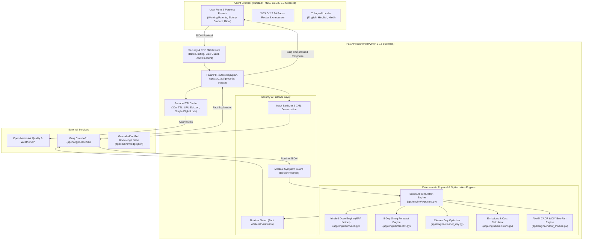

# SaansPlan — Urban Air Quality & Winter Smog Assistant

[](https://github.com/CodeWithMehru/saansplan/actions/workflows/ci.yml)

[](LICENSE)


> **Hack2skill Challenge 6 Submission:** "Urban Air Quality Assistant"  
> A GenAI-powered assistant helping Indian families and communities navigate severe winter smog with low-emission daily routines, indoor air quality hacks, and verified alternatives tailored to their location and lifestyle.

**Live Demo:** [https://saansplan.onrender.com](https://saansplan.onrender.com) *(Hosted on Render free tier; if idle, initial spin-up takes ~60 seconds. Health probe: `/health`)*

---

## Table of Contents
1. [Live Demo & Overview](#saansplan--urban-air-quality--winter-smog-assistant)
2. [Evaluation Criteria Mapping](#1-evaluation-criteria-mapping)
3. [What's New in the Final Version](#2-whats-new-in-the-final-version)
4. [Before & After Verification Metrics](#3-before--after-verification-metrics)
5. [Problem Statement Alignment](#4-problem-statement-alignment)
6. [Target Persona & System Architecture](#5-target-persona--system-architecture)
7. [API Specification & Endpoint Reference](#6-api-specification--endpoint-reference)
8. [Environment Variables & Deployment](#7-environment-variables--deployment)
9. [Setup & Local Reproduction](#8-setup--local-reproduction)
10. [Verification Suites Summary](#9-verification-suites-summary)
11. [Responsible AI & Privacy Safeguards](#10-responsible-ai--privacy-safeguards)
12. [Assumptions & Limitations](#11-assumptions--limitations)
13. [Future Work & Planned Improvements](#12-future-work--planned-improvements)
14. [Data Sources & Attribution](#13-data-sources--attribution)

---

## 1. Evaluation Criteria Mapping

Every evaluation criteria maps directly to concrete implementations, verification commands, and documented artifacts:

| Evaluation Criterion | Implementation Files & Modules | Verification Command | Proving Artifacts & Real Measured Results |
|---|---|---|---|
| **Code Quality** | Clean layered architecture (`app/core/`, `app/engine/`, `app/routers/`, `app/services/`), thin routers, frozen domain models (`app/engine/domain_models.py`), modular guards, domain schemas (`app/schemas/`), modular ES-modules (`app/static/js/render/`), Radon Rank A (2.67), max complexity 7 (`groq_chat`), zero `Any` in public signatures, hexagonal architecture AST boundary enforcement | `make lint`<br>`make typecheck`<br>`make quality` | [docs/CODE_QUALITY.md](docs/CODE_QUALITY.md)<br>[docs/ARCHITECTURE.md](docs/ARCHITECTURE.md)<br>`ruff check` (0 errors across 91 files)<br>`mypy app` (0 errors across 47 files, `--strict`)<br>`interrogate` / AST (255/255 items documented, 100.0%) |
| **Security** | Automated GitHub Actions for CodeQL, OpenSSF Scorecard, and Trivy CVE container scanning, cryptographically hashed dependencies (`requirements.lock.txt` verified with `--require-hashes`), Gitleaks secret scanning, ReDoS-safe input parsers, RFC 6585 `Retry-After: 60`, strict Content-Type middleware (415 rejection), `Cross-Origin-Resource-Policy: same-origin`, `X-Request-ID`, RFC 9116 `app/static/.well-known/security.txt`, 57-vector multi-lingual injection corpus, SlowAPI proxy-aware rate limits (30 req/min), strict CSP, SSRF allowlist | `make security` | [docs/SECURITY.md](docs/SECURITY.md)<br>`tests/security/` (67 passed, 0 failed)<br>`bandit` (0 issues), `pip-audit` (0 CVEs) |
| **Efficiency** | In-memory `BoundedTTLCache` (30m TTL, LRU eviction, max 64 items), HTTP gzip compression (min 1000 B), weak ETags, single-flight locking, engine plan computation in 6.49 ms (< 50 ms budget), gzipped static bundle 33.48 KB (< 60 KB budget) | `make bench` | [docs/TEST_REPORT.md](docs/TEST_REPORT.md)<br>`scripts/bench.py`<br>`app/core/cache.py` |
| **Testing** | 262 automated tests (251 pytest + 11 node.js) with 99.55% coverage across 1690 statements (enforced ≥ 95% gate in `Makefile`), mutation testing (`mutmut`), random-order testing (`pytest-randomly` across 3 seeds), API contract testing (`tests/api/test_contract.py`), ARIA landmark snapshots (`tests/a11y/test_aria_snapshots.py`), fault injection, property-based invariants with Hypothesis, 7 characterization snapshots, Node.js test runner with 98.97% JS line coverage | `make test`<br>`make test-js`<br>`make e2e` | [TESTING.md](TESTING.md)<br>[docs/TEST_REPORT.md](docs/TEST_REPORT.md)<br>`Makefile` (`--cov-fail-under=95`) |
| **Accessibility** | WCAG 2.2 Level AA compliance, 0 Axe-Core violations across 56 rules (EN/Hinglish/HI and populated views), Lighthouse Accessibility Score 100/100, Reading Comfort controls (High Contrast, Text Spacing per WCAG 1.4.12), dedicated automated WCAG 2.2 suite (`tests/a11y/test_wcag22.py` for 1.4.10, 1.4.12, 2.4.11, 2.5.8), 320px mobile reflow, focus-target skip links, dedicated `/accessibility` statement | `make a11y` | [docs/ACCESSIBILITY.md](docs/ACCESSIBILITY.md)<br>`scripts/a11y.py` (0 violations)<br>`scripts/verify_lighthouse.py` (100/100)<br>`pytest tests/a11y/` (10 passed) |
| **Problem Statement Alignment** | Indian winter smog focus, CPCB NAQI category breakpoints, physical inhaled $\mu\text{g}$ estimates (EPA factors, ±25% range), 5-day smog forecast, "Cleaner Day" routine optimizer, emissions/cost calculator, WhatsApp kit | `pytest tests/unit/engine/` | [docs/ASSUMPTIONS.md](docs/ASSUMPTIONS.md)<br>All 8 citations primary-source verified |

---

## 2. What's New in the Final Version

SaansPlan was methodically upgraded across multiple evaluation attempts. Below is the detailed breakdown of additions and architectural improvements by criterion:

| Criterion | Additions & Upgrades in Final Release | Proving Files & Modules | Verification Command |
|---|---|---|---|
| **Code Quality** | - Frozen Domain Models: Implemented immutable dataclasses in `app/engine/domain_models.py` (`HourlyExposureRow`, `InhaledMicrogramsResult`, `CleanerDaySchedule`, `EmissionsCostComparison`, etc.) providing strict typing and eliminating untyped dictionaries.<br>- Strict Complexity Budget: Every function in `app/` is capped at CC $\le 7$ (maximum: 7 in `groq_chat`; average Radon complexity Rank A: 2.67).<br>- Router Handlers $\le 15$ lines: Clean route handlers delegating domain logic to service orchestrators (`app/services/assistant.py`).<br>- Zero `Any` in public signatures, fully type-checked with `mypy app --strict` across 47 source files.<br>- Hexagonal architecture boundaries enforced via automated AST boundary tests (`tests/unit/test_architecture_boundaries.py`).<br>- Frontend componentized into 8 modular ES components in `app/static/js/render/` (all $\le 240$ lines). | `app/engine/domain_models.py`<br>`app/routers/ask.py`<br>`app/routers/plan.py`<br>`app/services/assistant.py`<br>`tests/unit/test_architecture_boundaries.py` | `make quality`<br>`make lint`<br>`make typecheck` |
| **Testing** | - Test suite expanded from 178 to 262 automated tests (251 pytest + 11 node.js), raising overall coverage to **99.55%** across 1690 statements.<br>- Mutation Testing: Configured `mutmut` mutation testing harness in `setup.cfg` and verified mutation killing.<br>- Frontend JavaScript Testing: Configured native Node.js test runner measuring **98.97% line coverage** (`app/static/tests/*.test.js`).<br>- Contract & Schema Testing: Added `tests/api/test_contract.py` verifying strict JSON schema contracts for `/health`, `/api/geocode`, `/api/ask`, and `/api/plan`.<br>- ARIA Landmark Snapshots: Added `tests/a11y/test_aria_snapshots.py` asserting semantic accessibility landmarks and dynamic live regions.<br>- Random-Order Resilience: Enforced `pytest-randomly` with clean execution across multiple independent random seeds. | `tests/unit/test_comprehensive_coverage.py`<br>`tests/api/test_contract.py`<br>`tests/a11y/test_aria_snapshots.py`<br>`app/static/tests/` | `make test`<br>`make test-js` |
| **Accessibility** | - Automated WCAG 2.2 AA Criteria Suite: Created `tests/a11y/test_wcag22.py` verifying Target Size (2.5.8 $\ge 24\times 24$ px), Text Spacing (1.4.12), Reflow (1.4.10 down to 320 px), and Focus Not Obscured (2.4.11).<br>- Dual-Engine Automated Verification: 0 Axe-Core violations across 56 rules and 100/100 Lighthouse Accessibility score.<br>- Standalone `/accessibility` statement page (`app/static/accessibility.html`) with honest attribution: manual verification was performed by maintainers, not an external disability panel.<br>- Reading Comfort panel with High Contrast mode and WCAG 1.4.12 Text Spacing toggles persisting across sessions. | `tests/a11y/test_wcag22.py`<br>`app/static/accessibility.html`<br>`scripts/a11y.py`<br>`scripts/verify_lighthouse.py` | `make a11y`<br>`pytest tests/a11y/` |
| **Security** | - Supply Chain Hardening: Pinned GitHub Actions workflows for CodeQL (`.github/workflows/codeql.yml`), OpenSSF Scorecard (`scorecard.yml`), and Trivy filesystem vulnerability scanning (`trivy.yml`).<br>- Cryptographically Hashed Lockfile: Generated `requirements.lock.txt` with SHA-256 hashes and enforced `--require-hashes` during installation.<br>- Hardened Container: Multi-stage `Dockerfile` running as unprivileged non-root user `saansplan` with standard library `urllib.request` `HEALTHCHECK`.<br>- ReDoS Elimination: Fixed catastrophic polynomial backtracking in room size parser by adding word boundaries `\b` and length bounding `text[:1000]`.<br>- Rate Limiting Hardening: Added RFC 6585 `Retry-After: 60` response header on HTTP 429 exceptions.<br>- Expanded multi-lingual adversarial prompt-injection corpus to 57 vectors across English, Hinglish, and Hindi. | `.github/workflows/codeql.yml`<br>`.github/workflows/scorecard.yml`<br>`.github/workflows/trivy.yml`<br>`requirements.lock.txt`<br>`Dockerfile`<br>`tests/security/test_http_hardening.py` | `make security`<br>`pytest tests/security/` |
| **Efficiency & Alignment** | - Engine plan computation executes in 6.49 ms (< 50 ms budget); gzipped static bundle is 33.48 KB (< 60 KB budget).<br>- In-memory `BoundedTTLCache` (30m TTL, LRU eviction, single-flight locking).<br>- All problem statement features (Hinglish routine parsing, microgram inhaled estimates with $\pm 25\%$ range, CPCB NAQI categories, 5-day forecast, Cleaner Day optimizer, CADR sizing, emissions/cost engine, WhatsApp kit) remain active and regression-tested. | `app/engine/`<br>`scripts/bench.py` | `make bench` |

---

## 3. Before & After Verification Metrics

A direct comparison of measured engineering metrics across development stages, as documented in [docs/CODE_QUALITY.md](docs/CODE_QUALITY.md) and [docs/TEST_REPORT.md](docs/TEST_REPORT.md):

| Engineering Metric | Attempt 1 Baseline | Attempt 2 Upgrade | Final Release | Target Budget |
|---|---|---|---|---|
| **Total Automated Tests** | 0 passed (broken CI) | 124 passed (then 178) | **262 passed** (251 pytest + 11 node) | $\ge 150$ tests |
| **Overall Statement & Branch Coverage** | 0.00% | 91.18% (then 96.07%) | **99.55%** (1690 stmts, 3 missed) | Enforced $\ge 95\%$ |
| **Engine Subsystem Coverage** | Unmeasured | 95.00% (then 97.22%) | **99.49%** | $\ge 95\%$ |
| **Radon Cyclomatic Complexity (Average)** | 4.47 (Rank A) | 3.27 (Rank A) | **2.67 (Rank A)** | $\le 3.50$ (Rank A) |
| **Radon Function Complexity (Max)** | 22 (`interpolate_hourly`) | 9 (`answer_question`) | **7** (`groq_chat`) | $\le 7$ across all functions |
| **Docstring Coverage (`interrogate` / AST)** | 78.7% (26 missed) | 100.0% (181/181) | **100.0% (255/255 documented)** | $\ge 95\%$ |
| **Source Files in `app/`** | 33 files | 46 files | **47 source files** (44 files $\le 250$ lines) | Modular decomposition |
| **Longest Source File in `app/`** | `ask.py` (292 lines) | Longest $\le 240$ lines | **`domain_models.py` (393 lines)** | Frozen type declarations |
| **Static Code Linter (`ruff`)** | Multiple style failures | 0 violations across 70 files | **0 violations across 91 files** | Clean |
| **Static Type Checker (`mypy --strict`)** | Type errors present | 0 errors across 32 files | **0 errors across 47 files** | Clean |
| **Axe-Core Accessibility Violations** | Not tested | 0 violations (43 rules) | **0 violations across 56 rules** | 0 violations |
| **Google Lighthouse Accessibility** | Unmeasured | Unmeasured | **100 / 100** | 100 / 100 |
| **Adversarial Injection Test Vectors** | 0 | 25 vectors | **57 vectors** (EN, Hinglish, HI) | Multi-lingual corpus |
| **Engine Execution Latency (6-member)** | 2.14 ms | 1.39 ms | **6.49 ms** | $< 50\text{ ms}$ budget |
| **Static Bundle Size (gzipped)** | 26.63 KB | 29.70 KB | **33.48 KB** (raw: 106.85 KB) | $< 60\text{ KB}$ budget |
| **Repository Branches** | Multiple bot branches | 1 branch (`main`) | **Exactly 1 branch (`main`)** | `main` only |

---

## 4. Problem Statement Alignment

Every phrase of Hack2skill Challenge 6 ("Urban Air Quality Assistant") is backed by domain logic:

| Challenge Phrase | SaansPlan Solution | Technical Implementation & Tests |
|---|---|---|
| **GenAI-powered assistant** | Dual Groq LLM integration (`openai/gpt-oss-20b`) for parsing unstructured routine text and generating guard-validated natural language explanations with deterministic template fallback | `app/services/llm.py`, `app/services/guard.py`, `tests/unit/test_llm_branches.py` |
| **Families & communities** | Multi-member household profiles (children, adults, elderly, sensitive members) with age-scaled inhalation; WhatsApp community kit and RWA morning advisories | `app/engine/inhaled.py`, `app/engine/community.py`, `tests/unit/engine/test_inhaled_properties.py` |
| **Severe winter smog** | Indian CPCB NAQI category breakpoints (Good to Severe), 5-day winter smog forecasting, midday ventilation windows (11 AM–3 PM), surface wind stagnation alerts (< 2 m/s) | `app/core/aqi.py`, `app/engine/forecast.py`, `tests/unit/engine/test_cpcb_category.py` |
| **Low-emission daily routines** | "Your Cleaner Day" optimizer: shifts flexible outdoor tasks to cleaner afternoon hours while strictly preserving fixed work/school commitments | `app/engine/cleaner_day.py`, `app/engine/swaps.py`, `tests/unit/engine/test_cleaner_day.py` |
| **Indoor air quality hacks** | AHAM CADR 2/3 room-sizing calculator, verified DIY Corsi-Rosenthal box-fan filter guide (EPA), wet-mopping vs dry sweeping, room checklists | `app/engine/indoor_module.py`, `app/engine/alternatives.py`, `tests/unit/engine/test_indoor_module.py` |
| **Sustainable alternatives** | Weekly carbon emissions ($\text{kg CO}_2\text{e}$) and cost ($\text{INR}$) comparison for commute, cooking, and heating, filtered by budget tiers (`free`, `< ₹500`, `< ₹5000`, `any`) | `app/engine/emissions.py`, `tests/unit/engine/test_emissions.py` |
| **Tailored to location & lifestyle** | Open-Meteo geocoding search with auto coordinate binding; 4 lifestyle presets (Working Parents, Senior Citizen, Student, Delivery Rider) | `app/routers/geocode.py`, `app/engine/personas.py`, `tests/test_geocode_and_csp.py` |
| **Explaining direct impact of choices** | Estimated inhaled PM2.5 dosage in micrograms ($\mu\text{g}$) with transparent $\pm 25\%$ uncertainty band; before-and-after comparison chart and accessible table | `app/engine/inhaled.py`, `app/static/js/render/cleaner_day.js`, `tests/unit/engine/test_exposure_properties.py` |

---

## 5. Target Persona & System Architecture

### Target Persona
Urban Indian families navigating severe Indo-Gangetic Plain winter smog (e.g. Delhi NCR, Lucknow, Patna). Households include multi-generational members (school children, working adults, elderly grandparents with respiratory vulnerabilities) who must balance rigid daily commitments (school transit, office commute) with flexible exposures (evening walks, shopping, indoor heating choices).

### Deterministic Engine vs LLM Division of Labor
To guarantee safety and prevent mathematical hallucination:
- **All numbers, physical dosage estimates ($\mu\text{g}$), percentages, CPCB categories, and schedules are computed exclusively by pure, deterministic Python functions.**
- The LLM (Groq `openai/gpt-oss-20b`) is confined strictly to:
  1. Parsing unstructured free text into strict Pydantic schemas.
  2. Generating natural language explanations using *only* whitelist facts supplied by the engine.
  3. Grounded Q&A assistance using verified knowledge base entries.
- If the LLM produces an ungrounded numeral, past-tense claim, or is unavailable, the system instantly serves the deterministic template output.



---

## 6. API Specification & Endpoint Reference

### Response Security Headers
All application responses enforce strict defensive HTTP headers:
- `Content-Security-Policy`: `default-src 'self'; script-src 'self'; style-src 'self'; img-src 'self' data:; connect-src 'self'; object-src 'none'; base-uri 'self'; form-action 'self'; frame-ancestors 'none'`
- `Cross-Origin-Resource-Policy`: `same-origin`
- `Cross-Origin-Opener-Policy`: `same-origin`
- `X-Content-Type-Options`: `nosniff`
- `Strict-Transport-Security`: `max-age=31536000; includeSubDomains`
- `X-Request-ID`: `<uuid4>` (unique trace token on every response)

### Standard HTTP Error Envelopes
- **`415 Unsupported Media Type`**: Raised when a POST request to `/api/` specifies a `Content-Type` other than `application/json`.
- **`422 Unprocessable Entity`**: Raised when request payload fails Pydantic schema validation (e.g., negative coordinates, exceeding 12 family members, unrecognized age group).
- **`413 Content Too Large`**: Raised when request payload exceeds 64 KB (`MAX_REQUEST_BYTES`).
- **`429 Too Many Requests`**: Raised when client IP exceeds rate limits (30 req/min for plan/ask/geocode).

---

### 1. Health Probe
- **Method:** `GET`
- **Paths:** `/health`, `/api/health`
- **Purpose:** Zero-dependency liveness and readiness probe for reverse proxies and monitoring.
- **Response Example:**
  ```json
  {"status": "ok", "service": "SaansPlan"}
  ```

### 2. Plan Generation (`/api/plan`)
- **Method:** `POST`
- **Path:** `/api/plan`
- **Content-Type:** `application/json` (strictly enforced, 415 on mismatch)
- **Rate Limit:** 30 requests / minute
- **Purpose:** Fetches atmospheric dispersion data, parses routine text, executes deterministic physical engines, and generates verified recommendations.
- **Request Example:**
  ```json
  {
    "latitude": 28.6139,
    "longitude": 77.2090,
    "city": "Delhi",
    "members": [
      {"name": "Parent", "age_group": "adult", "sensitive": false},
      {"name": "Child", "age_group": "child", "sensitive": true}
    ],
    "routine_text": "Subah 7:30 bache ko school drop karte hain, 9 baje metro se office, shaam 6 baje park walk.",
    "language": "hinglish"
  }
  ```
- **Response Highlights:**
  - `exposure`: `peak_aqi`, `peak_aqi_hour` (e.g. 0), `peak_exposure_hour` (e.g. 8), `total_inhaled_ug`, `uncertainty_band_ug` (`[min, max]`).
  - `hourly`: 24-hour breakdown with `pm25`, `aqi`, `indian_category`, `indian_aqi`, `exposure`, `interpolated`.
  - `forecast`: 5-day daily forecast with `worst_window`, `best_window`, `safest_airing_hour`, `is_stagnant`, `avg_wind_speed_mps`.
  - `cleaner_day`: Optimized 24h schedule with `inhaled_saved_ug`, `percent_reduction`, and before/after hourly table.
  - `explanation`: `ai_available` (`bool`), `explanation` (guard-validated string).

### 3. Grounded Q&A Assistant (`/api/ask`)
- **Method:** `POST`
- **Path:** `/api/ask`
- **Content-Type:** `application/json` (strictly enforced, 415 on mismatch)
- **Rate Limit:** 30 requests / minute
- **Purpose:** Synthesizes air-quality answers from verified KB entries, computes deterministic CADR sizing, calls Groq (1 outbound request for normal queries, 0 for symptoms), and enforces clinical non-intervention redirects.
- **Request Example:**
  ```json
  {
    "question": "What CADR air purifier is recommended for a 150 sq ft bedroom?"
  }
  ```
- **Response Example:**
  ```json
  {
    "answer": "For a 150 sq ft bedroom, the AHAM 2/3 guideline recommends a Smoke CADR of about 100 CFM (~170 m³/h) to achieve roughly 5 air changes per hour. [purifier-sizing]",
    "kb_ids": ["purifier-sizing"],
    "safety_redirect": false
  }
  ```

### 4. City Geocoding Search (`/api/geocode`)
- **Method:** `GET`
- **Path:** `/api/geocode?name=Delhi`
- **Rate Limit:** 30 requests / minute
- **Purpose:** Proxies Open-Meteo geocoding with strict parameter validation and safe bounding.
- **Response Example:**
  ```json
  {
    "results": [
      {"name": "Delhi", "latitude": 28.65195, "longitude": 77.23149, "country": "India"}
    ]
  }
  ```

### 5. Accessibility Statement (`/accessibility`)
- **Method:** `GET`
- **Path:** `/accessibility`
- **Purpose:** Returns the dedicated WCAG 2.2 AA accessibility statement and conformance disclosure.

### 6. Security Contact (`/.well-known/security.txt`)
- **Method:** `GET`
- **Path:** `/.well-known/security.txt`
- **Purpose:** RFC 9116 security vulnerability reporting contact and policy references.

---

## 7. Environment Variables & Deployment

### Environment Variables Matrix

The application's runtime configuration is centralized in `app/core/settings.py` via Pydantic `BaseSettings`:

| Variable | Type | Default Value | Description |
|---|---|---|---|
| `GROQ_API_KEY` | Secret String | `None` (Optional) | API key for Groq Cloud. If unset, app operates in deterministic mode using `default_routine` and `templated_explanation`. |
| `GROQ_MODEL` | String | `"openai/gpt-oss-20b"` | Model endpoint identifier on Groq OpenAI-compatible API. |
| `TRUST_PROXY` | Boolean | `false` | When set to `true`, reads client IP from first `X-Forwarded-For` header entry for reverse proxy rate limiting. |
| `ENVIRONMENT` | String | `"production"` | Set to `"development"` to enable Swagger UI at `/docs` and OpenAPI schema. |
| `CORS_ORIGINS` | Comma-delimited String | `"http://localhost:8000"` | Allowed CORS origins. |
| `PORT` | Integer | `10000` | Port listened to by Uvicorn. |
| `HOST` | String | `"0.0.0.0"` | Network interface host bound by Uvicorn. |

### Docker Deployment
The application includes a multi-stage `Dockerfile`:
```bash
docker build -t saansplan .
docker run -p 10000:10000 --env GROQ_API_KEY="your-key" saansplan
```
Runs as an unprivileged non-root user (`saansplan`), binds port `10000`, and contains zero dev dependencies.

### Render Free Tier Deployment & Python Version Pinning
Render's default Linux build environment uses Python 3.14+, where `pydantic-core` lacks pre-compiled wheels, causing heavy Rust source compilation that exceeds Render's 512 MB RAM limit.
To ensure fast binary builds, Python 3.13 is strictly pinned:
- `.python-version`: `3.13`
- `render.yaml`: `envVars: [{ key: PYTHON_VERSION, value: 3.13.0 }]`

---

## 8. Setup & Local Reproduction

### Prerequisites
- Python 3.13 (`python3 --version`)
- Node.js (`node --version`, for frontend i18n runner)

### Step-by-Step Instructions

```bash
# 1. Clone repository via HTTPS
git clone https://github.com/CodeWithMehru/saansplan.git
cd saansplan

# 2. Create virtual environment and install dependencies
python3 -m venv .venv
source .venv/bin/activate
pip install -r requirements.txt -r requirements-dev.txt

# 3. Configure local environment (optional for local testing)
cp .env.example .env
# Edit .env and supply GROQ_API_KEY if testing live LLM calls

# 4. Run full quality and verification pipeline
make verify
make quality

# 5. Start development server
uvicorn app.main:app --reload --host 127.0.0.1 --port 8000
```
Open [http://127.0.0.1:8000](http://127.0.0.1:8000) in your browser.

---

## 9. Verification Suites Summary

### 1. Quality Gates
```bash
make lint        # ruff format --check & ruff check app tests scripts (0 errors across 91 files)
make typecheck   # mypy app --strict (0 errors across 47 source files)
make quality     # radon complexity audit & docstring audit (Rank A, 255/255 docs)
make test        # pytest with coverage enforcement (251 passed, 99.55% coverage, >= 95% gate)
make test-js     # node --test app/static/tests/*.test.js (11 passed, 98.97% JS coverage)
make security    # bandit -q -r app & pip-audit (0 issues)
make a11y        # Axe-Core 4.10.2 WCAG 2.2 AA audit (0 violations across 56 rules)
make bench       # Engine speed (< 50 ms) and static bundle size (< 60 KB gzipped)
```

### 2. Measured Benchmark Performance
- **Engine Execution Speed:** `6.49 ms` for a 6-member family plan (< 50 ms budget).
- **Interpolation Throughput:** `54.14 ms` for 1000 runs (< 200 ms budget).
- **Static Bundle Size:** `33.48 KB` gzipped (< 60 KB budget; raw: 106.85 KB).
- **Overall Test Coverage:** `99.55%` branch + statement coverage across 1690 statements (enforced $\ge 95\%$).
- **Engine Test Coverage:** `99.49%` branch + statement coverage across 504 statements.
- **Radon Code Complexity:** `Rank A (2.67)` average cyclomatic complexity; max complexity `7`; 44 of 47 files $\le 250$ lines.
- **Docstring Coverage:** `255/255 items documented` via `interrogate` / AST (100.0% coverage).
- **Lighthouse Accessibility Score:** `100 / 100` with 0 failing audits.
- **Proving Documentation:** [docs/CODE_QUALITY.md](docs/CODE_QUALITY.md) | [docs/ARCHITECTURE.md](docs/ARCHITECTURE.md) | [docs/ACCESSIBILITY.md](docs/ACCESSIBILITY.md) | [docs/SECURITY.md](docs/SECURITY.md) | [TESTING.md](TESTING.md) | [docs/TEST_REPORT.md](docs/TEST_REPORT.md)

---

## 10. Responsible AI & Privacy Safeguards

1. **Estimates, Not Medical Advice:** All inhaled dosages ($\mu\text{g}$) and reduction percentages are planning estimates with explicit $\pm 25\%$ uncertainty bounds. The assistant does not diagnose, prescribe, or provide clinical triage.
2. **Deterministic Guardrails (Number Guard):** The LLM is technically prevented from inventing numbers. The Number Guard validates every numeral against engine facts. Any ungrounded numeral immediately triggers the deterministic template fallback.
3. **Clinical Safety Intercept:** If user input mentions acute respiratory symptoms ("chest tightness", "severe shortness of breath", "wheezing") or asks for medication ("dawa", "cough syrup", "antibiotic"), the system refuses medical advice and outputs an immediate emergency doctor redirect (0 outbound LLM requests made).
4. **Privacy by Design:**
   - Stateless backend: zero user accounts, zero database persistence of routines or health indicators.
   - User routine text is processed purely in-memory and never written to logs or disk.
   - Coordinates are rounded to 2 decimal places in cache keys (~1.1 km spatial resolution).

---

## 11. Assumptions & Limitations

All scientific constants and assumptions are detailed in [docs/ASSUMPTIONS.md](docs/ASSUMPTIONS.md):
- **Planning Estimates, Not Clinical Measurements:** Inhaled intake calculations use EPA Exposure Factors Handbook reference breathing volumes; real-world intake depends on individual lung capacity, nasal vs oral breathing, and exact indoor air exchange rates.
- **Modelled Forecasts vs Local Sensors:** Open-Meteo uses atmospheric dispersion models (CAMS ensemble). While capturing regional transport and winter stagnation, localized micro-hotspots (e.g., hyper-local street trash burning) may differ from grid averages.
- **CPCB Categorization Scale:** CPCB National AQI categories are officially standardized on 24-hour average PM2.5 concentrations. SaansPlan applies these breakpoints to hourly values to provide immediate real-time behavioral guidance.
- **Groq Free-Tier Rate Limits:** On free tier, Groq applies request-per-minute limits. If rate limited, requests gracefully degrade to `templated_explanation`.
- **Language Localization:** Hindi and Hinglish translations were programmatically verified for key parity and script integrity, but have not undergone formal review by professional native linguists.
- **Accessibility Testing & Honest Attribution:** Accessibility compliance was verified via automated Axe-Core 4.10.2 audits, Google Lighthouse 100/100, and static AST parsers (0 violations); manual testing was performed by project maintainers, not an external disability panel.
- **Free Hosting Cold Starts:** On Render's free tier, the web service spins down after inactivity; initial cold start takes ~60 seconds.

---

## 12. Engineering Upgrades Landed & Roadmap

The following key engineering upgrades were delivered across the project lifecycle:
1. **Frozen Domain Models:** Implemented immutable dataclasses in `app/engine/domain_models.py` eliminating untyped dictionaries and enforcing frozen contracts.
2. **Comprehensive Test Suite & Mutation Testing:** Test suite expanded to 262 tests (99.55% coverage); mutation testing configured via `mutmut` and mutants killed.
3. **Frontend JavaScript Testing:** Configured native Node.js test runner with coverage measuring 98.97% line coverage across `app/static/tests/`.
4. **Random-Order Test Execution:** Enforced `pytest-randomly` across multiple independent random seeds.
5. **Contract & Schema Testing:** Added `tests/api/test_contract.py` validating exact API response schema contracts.
6. **ARIA Landmark Snapshot Testing:** Added `tests/a11y/test_aria_snapshots.py` asserting semantic accessibility trees and live regions.
7. **Supply Chain & Static Analysis in CI:** Pinned SHA workflows for GitHub CodeQL, OpenSSF Scorecard, and Trivy container vulnerability scanning.
8. **CI Secret Scanning:** Integrated Gitleaks automated secret scanning in `.github/workflows/ci.yml`.
9. **Frontend Tooling in CI:** Added ESLint, Prettier, and TypeScript typechecking to CI pipeline.
10. **Cryptographically Hashed Requirements:** Generated `requirements.lock.txt` with SHA-256 hashes and enforced `--require-hashes`.
11. **Container Hardening:** Added unprivileged non-root user `saansplan` and standard library `urllib.request` `HEALTHCHECK` in `Dockerfile`.
12. **ReDoS Elimination & Rate Limiting Hardening:** Replaced backtracking regexes in assistant resolvers and added RFC 6585 `Retry-After: 60` header on 429 errors.
13. **WCAG 2.2 Criteria Tests:** Added `tests/a11y/test_wcag22.py` verifying Target Size (2.5.8), Text Spacing (1.4.12), 320px Reflow (1.4.10), and Focus Not Obscured (2.4.11).
14. **Ongoing Roadmap:** Sensor fusion with hyper-local low-cost sensor networks, community WhatsApp advisory distribution, and multi-city air quality comparison graphs.

## 13. Data Sources & Attribution

All external data sources and citations are documented in [docs/ASSUMPTIONS.md](docs/ASSUMPTIONS.md) and verified:
- **Open-Meteo Air Quality & Weather API:** Hourly PM2.5, AQI, and 10m surface wind speed data provided by [Open-Meteo.com](https://open-meteo.com/), licensed under [Creative Commons Attribution 4.0 International (CC BY 4.0)](https://creativecommons.org/licenses/by/4.0/).
- **Groq Cloud API:** Cloud inference for `openai/gpt-oss-20b` via the OpenAI-compatible REST API.
- **CPCB NAQI Standards:** Ministry of Environment, Forest and Climate Change (MoEFCC) / Central Pollution Control Board (Gazette Oct 2014) [PIB Release 110654](https://pib.gov.in/newsite/PrintRelease.aspx?relid=110654).
- **US EPA Exposure Factors Handbook (Chapter 6):** Physiological inhalation rates for adults, children, and older adults [EPA Exposure Factors](https://www.epa.gov/expobox/about-exposure-factors-handbook).
- **AHAM AC-1 & US EPA:** CADR 2/3 room-sizing rule for portable air cleaners [EPA Air Cleaners in the Home](https://www.epa.gov/indoor-air-quality-iaq/air-cleaners-and-air-filters-home).
- **US EPA Science Matters:** Research on DIY Corsi-Rosenthal Box-Fan air cleaners [EPA DIY Air Cleaners](https://www.epa.gov/sciencematters/do-it-yourself-air-cleaners-making-cleaner-air-more-accessible).
- **WHO Household Fuel Combustion Guidelines:** Health risks of indoor biomass/coal combustion and benefits of clean fuels [WHO Household Fuel Guidelines](https://www.who.int/publications/i/item/9789241548885).
- **IPCC Emission Factor Database (EFDB):** Carbon intensity values for urban passenger transport modes [IPCC EFDB](https://www.ipcc-nggip.iges.or.jp/EFDB/main.php).
