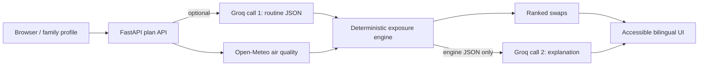

# SaansPlan

SaansPlan is a submission-ready urban air-quality assistant for **Indian urban families—children, adults, elderly and sensitive members—living through winter smog**.

## Problem and approach

Winter smog can change sharply by hour and by indoor activity. SaansPlan combines an hourly Open-Meteo PM2.5/AQI forecast with a deterministic, transparent exposure engine. Groq is used only to parse free-text routines and explain engine-produced numbers in short Hinglish or English. The engine remains usable without Groq, so form-only users receive a full plan.

## How it works



1. Choose a location manually or with browser geolocation.
2. Add child/adult/elderly family members in browser localStorage.
3. Enter a Hinglish/English routine or use form controls.
4. Open-Meteo supplies hourly PM2.5 and US AQI.
5. Groq call 1 parses text to strict Pydantic JSON.
6. The engine estimates family exposure, peaks and ranked swaps.
7. Groq call 2 explains only engine numbers; unknown numbers trigger a retry and then a template.
8. The UI shows timeline, swaps, indoor hacks, alternatives and copyable family text.

## Challenge traceability

| Challenge requirement | Where implemented |
|---|---|
| GenAI-powered assistant; Groq in two places | `app/services/llm.py` `parse_routine`, `explain_with_fallback` |
| Families and communities | `app/models.py` FamilyMember; `app/static/app.js` localStorage; share summary |
| Severe winter smog | `app/services/air_quality.py`; `app/engine/exposure.py` hourly/peak; home heating/cooking |
| Low-emission daily routines | `app/engine/swaps.py` `generate_swaps`; timeline |
| Indoor air quality hacks | `app/engine/alternatives.py` `indoor_hacks` |
| Sustainable alternatives | `app/engine/alternatives.py` `sustainable_alternatives` |
| Tailored to location and lifestyle | `app/routers/plan.py`; family, routine and home inputs |
| Direct impact before/after | `generate_swaps` and `app/static/app.js` card rendering |

## Setup

```bash
python3 -m venv .venv
.venv/bin/pip install -r requirements.txt
cp .env.example .env
# Put your key only in .env
.venv/bin/uvicorn app.main:app --reload --host 0.0.0.0 --port 8000
```

Open `http://localhost:8000`. `.env` is ignored by git.

Environment variables:

- `GROQ_API_KEY`: required for Groq calls; never browser-visible.
- `GROQ_MODEL`: defaults to `openai/openai/gpt-oss-20b`; override to another official Groq model ID.
- `CORS_ORIGINS`: comma-separated allowed browser origins.

## Tests and coverage

```bash
.venv/bin/ruff check app tests
.venv/bin/ruff format --check app tests
.venv/bin/pytest --cov=app --cov-report=term-missing -q
```

## Deploy on Render

1. Push `main` to the public GitHub repository.
2. Create a Render Web Service from the repository.
3. Render uses `render.yaml`: Python, `pip install -r requirements.txt`, and Uvicorn.
4. Set `GROQ_API_KEY` in Render's environment settings. Do not put it in YAML or the frontend.
5. Set `GROQ_MODEL=openai/openai/gpt-oss-20b` if not inherited.
6. Deploy and open the generated HTTPS URL.

## Assumptions and limitations

- PM2.5 and AQI are supplied by Open-Meteo. Missing values are linearly interpolated; interpolated timeline cells are marked.
- Exposure is a relative estimate, not an atmospheric, dose or medical model.
- Constants in `app/config.py` are conservative approximations and are labelled `ASSUMPTION - approximate, see README Assumptions`.
- Breathing factors and sensitivity multipliers are planning assumptions informed by US EPA activity/exposure concepts and WHO indoor-air guidance. They are not medical facts.
- Infiltration, purifier, mask and source increments are simplifying assumptions. A real purifier is not guaranteed to match the assumed factor.
- AQI/PM2.5 data may lag, omit local sources or vary by neighbourhood.

## Security

- Groq key is server-side only.
- Pydantic rejects bad types, ranges, enums and extra fields.
- Request bytes are limited and plan requests are IP-rate-limited.
- Free text is bracketed as untrusted data; fixed prompts do not permit tools or actions.
- Strict JSON schemas and the number guard validate LLM output.
- No personal health data is stored server-side; family profile stays in browser localStorage.

## Accessibility

- Semantic HTML, fieldsets, labels, skip link and visible keyboard focus.
- `aria-live` status/errors and a text/table alternative for timeline charts.
- Text and icons accompany AQI colours.
- English/Hinglish toggle; small mobile layout; no horizontal page overflow.
- Respects reduced motion and dark/colour preference.

## Gen AI use

Groq is the only GenAI provider. It uses `openai/openai/gpt-oss-20b` by default. Call 1 converts routine text to strict JSON. Call 2 writes a short explanation using only engine JSON. A maximum of two calls is made per plan. Invalid/unknown-number output is retried once, then replaced by a deterministic template. The default model can be changed with `GROQ_MODEL`.
