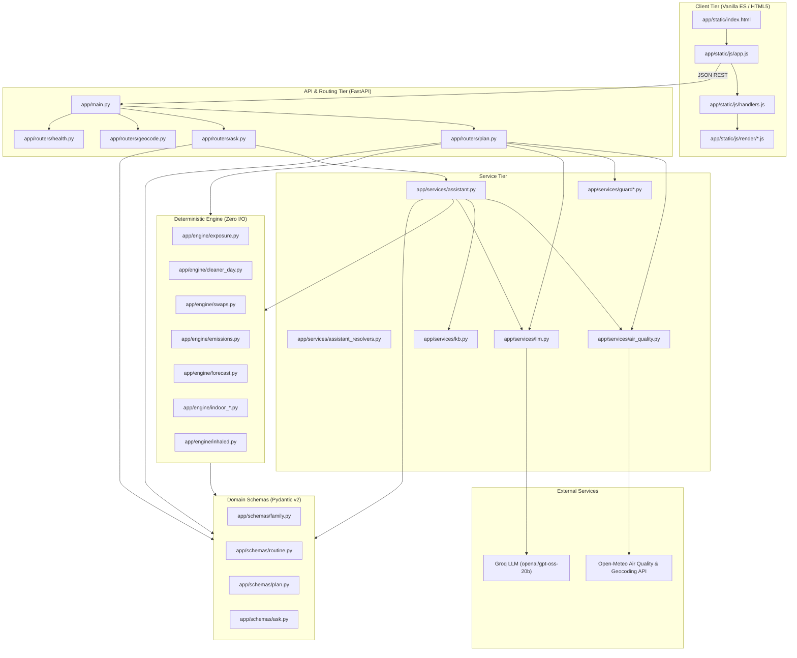

# System Architecture

## Overview

SaansPlan is an urban air quality assistant built with FastAPI, vanilla ECMAScript modules, and a pure deterministic mathematical engine. It provides family-tailored low-emission daily routines, indoor air quality hacks, and sustainable alternatives with clear impact explanations.

## Architectural Principles & Boundaries

1. **Unidirectional Dependency Invariant:**
   - Routers depend on Services, Schemas, and the Engine.
   - Services orchestrate I/O and external clients.
   - Engine modules are **strictly pure and deterministic**: zero network calls, zero file system I/O, zero random numbers, and zero imports from routers or external clients.
   - Schemas are self-contained data models with input sanitization.
   - Verified continuously via AST analysis in `tests/unit/test_architecture_boundaries.py`.

2. **Thin Routers & Modular Services:**
   - Routers perform request validation, route dispatching, and HTTP response mapping.
   - Business orchestration logic resides in specialized services (`app/services/assistant.py`, `app/services/guard_numbers.py`, `app/services/guard_safety.py`, `app/services/guard_wording.py`).

3. **Deterministic Fallbacks:**
   - LLM generation is strictly guarded. If Groq is unavailable, rate-limited, returns malformed text, violates clinical safety criteria, uses prohibited past-tense wording, or invents numeric values, the system seamlessly returns verified deterministic templates with zero downtime (`ai_available=false`).

4. **Hermetic & Offline-Capable Testing:**
   - The entire core test suite executes hermetically without requiring external network access or API secrets.
