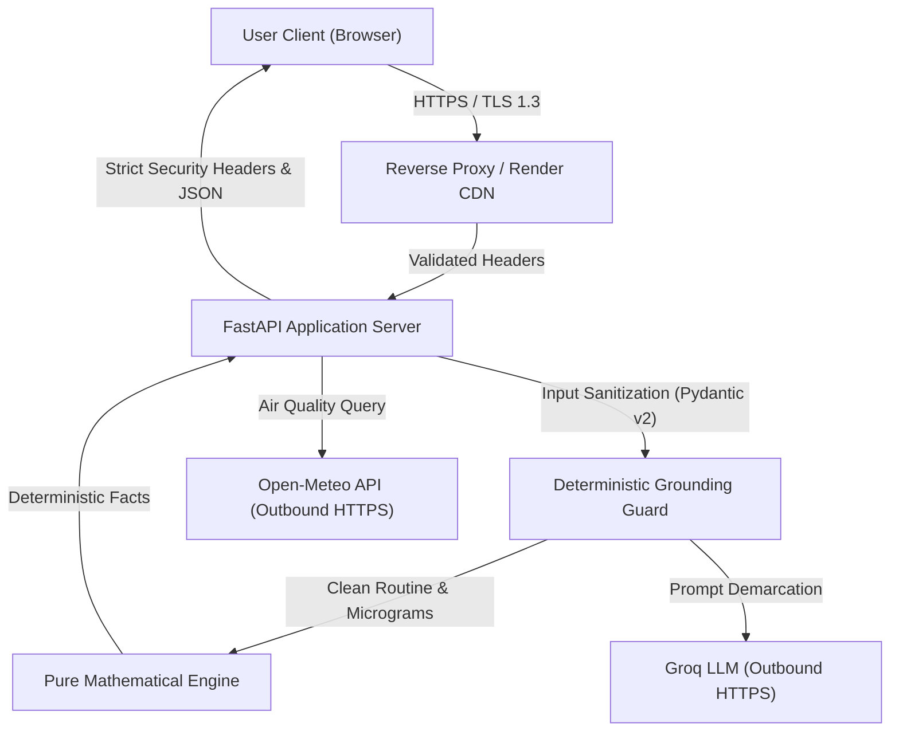

# Security Architecture & STRIDE Threat Model

SaansPlan processes urban air quality data and sensitive household routines. Our defense-in-depth security model ensures user privacy, zero credential exposure, strict sandboxing against prompt injections, and resilient defense against abuse.

---

## 1. Data-Flow Diagram (DFD)



---

## 2. STRIDE Threat Model Matrix

| STRIDE Category | Asset / Surface | Threat Description | Mitigation in SaansPlan | Proving Test / Verification |
|---|---|---|---|---|
| **Spoofing** | Client IP & Geolocation | Spoofed `X-Forwarded-For` header attempting to bypass rate limits or track users | SlowAPI limiter uses trusted proxy resolver: client IP header is trusted only when `TRUST_PROXY=true` is explicitly set | `tests/security/test_real_client_ip.py`, `tests/unit/test_fault_injection.py` |
| **Tampering** | API Request Payloads | Malformed or oversized JSON payloads injected into API | Pydantic v2 input schemas with `extra="forbid"`, control character stripping, and 64 KB size limit (`MAX_REQUEST_BYTES`) | `tests/test_schema_validation.py`, `tests/security/test_http_hardening.py` |
| **Repudiation** | API Logs & Diagnostics | Lack of traceable audit logs for API issues | Unique `X-Request-ID` attached to all HTTP responses and logged with timestamps and error codes | `tests/security/test_http_hardening.py`, `app/main.py` |
| **Information Disclosure** | `GROQ_API_KEY` & User PII | API key leakage in logs/headers; user routine PII exposure | Zero server persistence (stateless); `.env` gitignored; coordinates rounded to 2 decimals (~1.1 km resolution); key never returned | `tests/security/test_http_hardening.py`, `git status`, `tests/test_security.py` |
| **Denial of Service** | API Routers & Outbound calls | ReDoS regex exhaustion, memory bloat, or upstream hanging | ReDoS-safe linear regexes; bounded TTL cache (128 entries max); single-flight in-flight deduplication; 10s timeout on external calls | `tests/unit/test_cache.py`, `tests/test_air_quality.py` |
| **Elevation of Privilege** | LLM System Prompt & Assistant | Prompt injections, jailbreaks, or clinical medical prescriptions | Triple-layer defense: system prompt demarcation (`<user_routine>`), clinical keyword interception (`check_safety`), and deterministic fallback | `tests/security/test_prompt_injection.py` (48 adversarial vectors in EN, Hinglish, HI) |

---

## 3. Production HTTP Security Headers

Every HTTP response dispatched by `app/main.py` enforces modern defensive headers:

```http
Content-Security-Policy: default-src 'self'; script-src 'self'; style-src 'self'; img-src 'self' data:; connect-src 'self'; object-src 'none'; base-uri 'self'; form-action 'self'; frame-ancestors 'none'
X-Content-Type-Options: nosniff
Referrer-Policy: strict-origin-when-cross-origin
Permissions-Policy: geolocation=(self), camera=(), microphone=()
Strict-Transport-Security: max-age=31536000; includeSubDomains
Cross-Origin-Opener-Policy: same-origin
Cross-Origin-Resource-Policy: same-origin
X-Request-ID: <unique-id>
Cache-Control: no-store (for API responses)
```

- **Strict CSP:** Scripts and styles are restricted strictly to `'self'`. No `unsafe-inline`, no `unsafe-eval`, and no external third-party CDN scripts.
- **Strict Content-Type Enforcement:** POST requests to `/api/` endpoints must declare `Content-Type: application/json`; non-JSON requests are immediately rejected with `415 Unsupported Media Type`.
- **Request Size Guard:** Payloads exceeding 64 KB (`MAX_REQUEST_BYTES`) are terminated immediately with HTTP 413.

---

## 4. Supply Chain & CI Security Controls

1. **SHA-Pinned GitHub Actions:** All third-party GitHub Actions in `.github/workflows/ci.yml` are pinned to full 40-character commit SHAs verified via the GitHub API, preventing tag-mutation supply chain attacks.
2. **Least Privilege Workflows:** Top-level permissions are locked down to `permissions: contents: read`.
3. **Automated Vulnerability Scans:** `bandit -q -r app` and `pip-audit -r requirements.txt` execute on every commit and weekly on schedule.
4. **RFC 9116 Security Policy:** Standardized security contact information is hosted at `/.well-known/security.txt`.

---

## 5. Vulnerability Reporting & Disclosure

We appreciate responsible security disclosures. If you discover a potential vulnerability:
1. Submit a private advisory via [GitHub Security Advisories](https://github.com/CodeWithMehru/saansplan/security/advisories/new).
2. Or contact the maintainers following the instructions in `/.well-known/security.txt`.
3. Please do not create public GitHub issues for security vulnerabilities.
